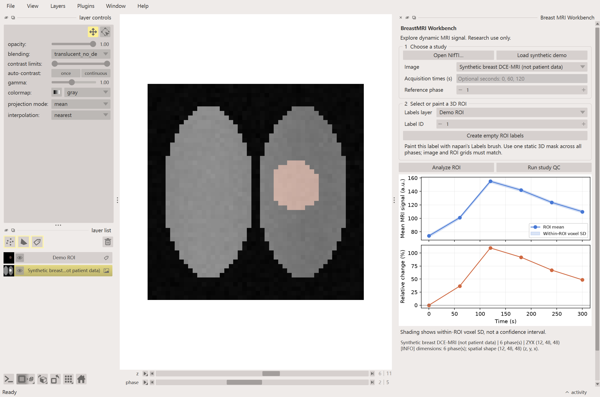
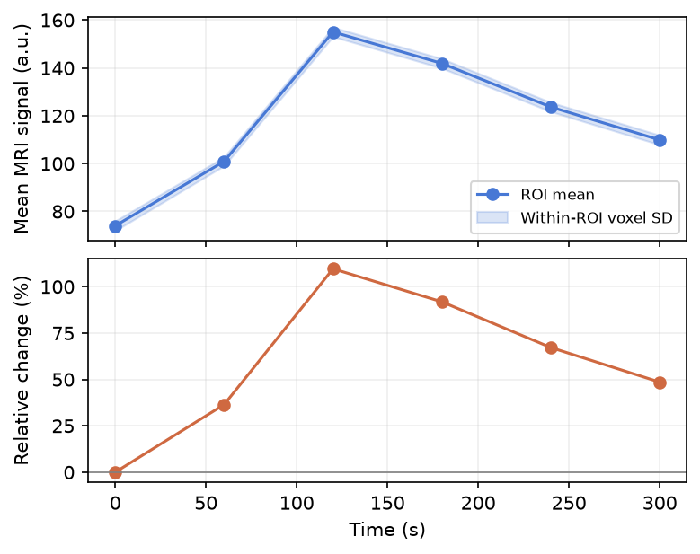

# BreastMRI-Workbench

[](https://github.com/a978623/BreastMRI-Workbench/actions/workflows/ci.yml)


**乳腺动态增强 MRI 的可视化、ROI 信号曲线与数据质控工具。**

A napari plugin for inspecting breast DCE-MRI time series, drawing static ROIs,
checking data consistency and exporting reproducible analysis reports.

This is a research and education prototype, not a diagnostic tool. The bundled
demo is generated mathematically and contains **no patient data**.

## What you can do

- Load one 3D/4D NIfTI file or an explicitly ordered list of 3D NIfTI phases.
- Browse volumes and phases in napari, create a 3D Labels layer and paint an ROI.
- Plot ROI mean signal, voxel standard deviation and relative signal enhancement.
- Check missing timing, non-finite values, constant phases and exact repeated volumes.
- Export CSV, JSON, PNG, a spatially referenced ROI NIfTI and a portable HTML report.
- Try the whole workflow using a deterministic synthetic study on a normal CPU.





## Install and launch

Use a fresh **Python 3.11 or 3.12** environment. Qt is supplied through PySide6.
No CUDA, trained model, API key or online service is needed at runtime.

```console
git clone https://github.com/a978623/BreastMRI-Workbench.git
cd BreastMRI-Workbench
python -m venv .venv
```

Activate the environment:

```powershell
# Windows PowerShell
.venv\Scripts\Activate.ps1
```

```bash
# macOS / Linux
source .venv/bin/activate
```

Then install and run:

```console
python -m pip install -e ".[gui]"
breast-mri-workbench --demo
```

Alternatively, run `napari` and open **Plugins → Breast MRI Workbench**.
The synthetic example is also available through napari's **File → Open Sample** menu.
The package has not been published to PyPI; install from this repository.

## Five-minute demo

1. Start with `breast-mri-workbench --demo` or click **Load synthetic demo** in the widget.
2. Select the demo image and demo Labels ROI. The default selected label is `1`.
3. Run ROI analysis and inspect both plots and the quality-check observations.
4. Change the phase with napari's dimension slider. Paint or erase the ROI using
   napari's Labels controls to see how your region changes the result.
5. Export to a new output folder. Open `report.html` in a browser or inspect the CSV/JSON.

To generate an example report without opening a desktop window:

```console
python -m napari_breast_mri --export-demo exports/demo
```

## Working with your own data

See [the data guide](docs/data-guide.md) for axis order, timing and alignment rules.
Start with a few small NIfTI studies, not an entire dataset download.

- The first version reads **NIfTI**. DICOM conversion and series grouping are not included.
- For separate phases, file order is the order you explicitly select. Filenames
  are not interpreted as acquisition times; verify order before analysis.
- Images must already share a physical grid. The reader rejects inconsistent
  shapes/affines and never silently registers or resamples the data.
- The current ROI is a static **3D Labels** mask. Shapes and time-varying masks
  are not included in v0.1.0.
- For images already in napari, the widget assumes **ZYX** (3D) or **TZYX** (4D).
- Verified NIfTI temporal metadata supplies seconds; otherwise the horizontal
  axis is a phase index. Missing timing is never replaced by invented timestamps.

The relative enhancement curve is `100 × (S(t) − S(baseline)) / S(baseline)`.
It is a signal ratio, **not** contrast concentration, Ktrans, tissue classification
or a clinical interpretation of curve shape. The shaded band is voxel SD,
not a confidence interval. Inspect motion and ROI correspondence manually.

## Outputs

| File | Contents |
| --- | --- |
| `roi_curve.csv` | One row per phase: signal mean/SD and relative enhancement |
| `summary.json` | Shape, voxel spacing, available timing, curve warnings and QC findings |
| `roi_curve.png` | Shareable two-panel curve figure |
| `roi_mask.nii.gz` | Selected binary ROI in canonical XYZ coordinates with its affine |
| `report.html` | Portable report with its image embedded; no remote assets |

Exports omit input file paths and image names. Existing report files are not
overwritten. Do not add real research images or participant identifiers to Git;
use the synthetic demo for public screenshots.

## Development

```console
python -m pip install -e ".[gui,dev]"
python -m pytest
python -m ruff check .
npe2 validate src/napari_breast_mri/napari.yaml
python -m build
python -m twine check dist/*
```

`requirements-tested.txt` records the main package versions used for the local
Windows/Python 3.12 validation. For that environment, install with
`python -m pip install -c requirements-tested.txt -e ".[gui,dev]"`.

Widget tests require a working Qt/OpenGL display and use `QT_API=pyside6`.
Linux CI uses Xvfb; Windows uses the native Qt backend. Qt's `offscreen` backend
does not provide the OpenGL context napari needs on this Windows environment.
The CI matrix checks Windows/Linux and Python 3.11/3.12; consult the Actions
badge for the status of a particular commit. See [architecture](docs/architecture.md)
and [the development roadmap](docs/roadmap.md) for extension points.

## Scope and attribution

This project implements its own study model, grid validation, ROI statistics,
quality checks, widget and reporting code. It uses napari's documented **npe2**
extension interface; it is not a fork of the napari application.

Dependencies and reference links are listed in [THIRD_PARTY.md](THIRD_PARTY.md).
The software is BSD-3-Clause licensed. No clinical dataset or pretrained weights
are redistributed, and no clinical performance claims are made.
